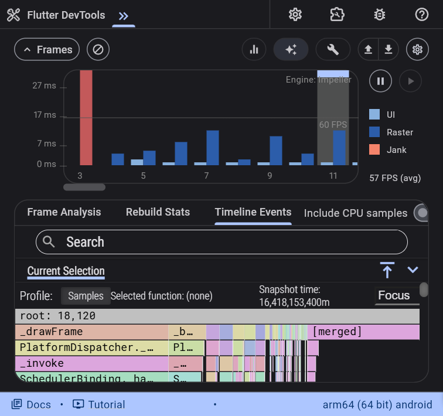
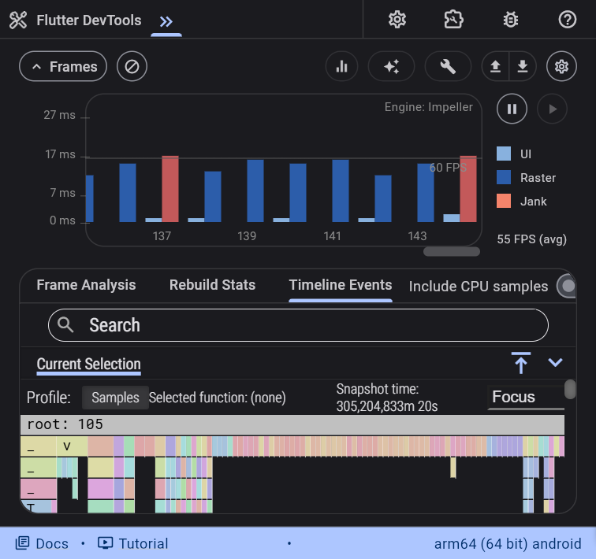
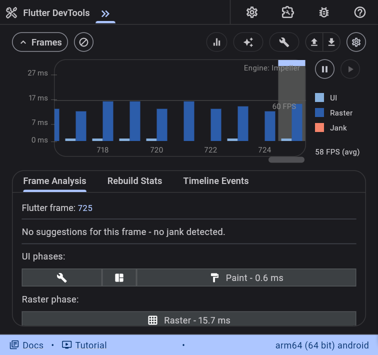
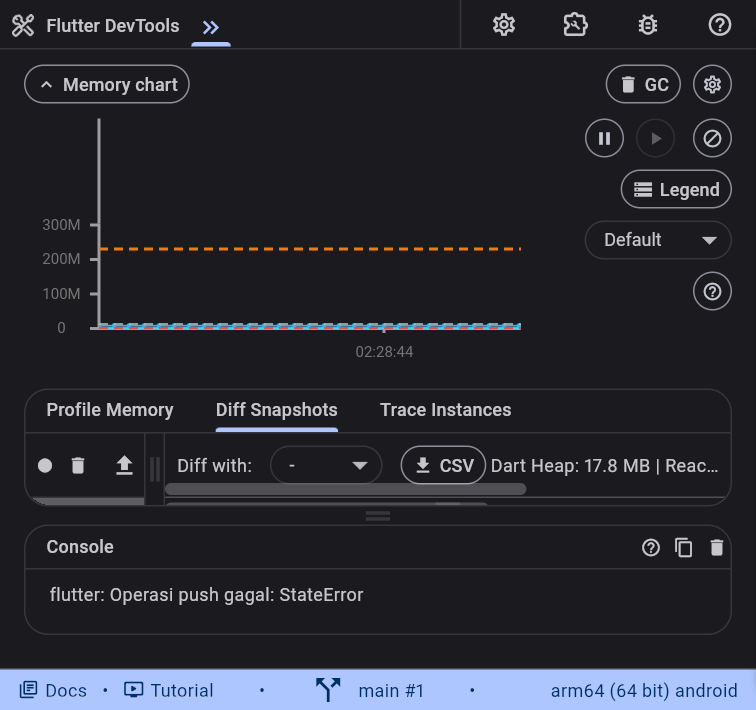

# Laporan Optimasi Performa — Minggu 11

Aplikasi: `campus_notify` (lanjutan Minggu 9/10). Fokus optimasi: layar
**Catatan** dan **Asisten AI**, karena keduanya yang paling sering memicu
rebuild dan repaint pada skenario profiling.

## 1. Lingkungan pengukuran

| Item | Nilai |
|---|---|
| Perangkat | OPPO CPH2473, Android, layar 720x1612 |
| Build | `flutter run --profile` (AOT) |
| Flutter / Dart | 3.47.6 stable / Dart 3.13.5 |
| Alat | DevTools 2.60.0 — Performance & Memory page |
| Data | 12 catatan lokal, API key sengaja tidak diatur |

Skenario profiling (sama sebelum dan sesudah): buka Catatan → scroll cepat
atas-bawah 3x → ketik dan hapus `Performa` → kembali → buka Asisten AI → chip
saran → dialog kunci API → **Mode Offline** → kirim "tes" → Tutup → kembali.
Untuk bukti tambahan dilakukan benchmark scroll cepat 3x tanpa intervensi lain.

## 2. Metrik baseline vs sesudah

| Metrik | Sebelum | Sesudah |
|---|---|---|
| Rata-rata FPS (Frames chart) | 57 FPS | 58 FPS (tanpa CPU samples) |
| Frame jank pada skenario | Raster jank hingga **27 ms** | **Tidak ada** frame > 16,7 ms pada scroll cepat; frame 725: Raster 15,7 ms |
| Fase UI frame terpilih | Build 0,7 ms, Paint 0,7 ms | Paint 0,6 ms (frame 725) |
| Rata-rata FPS dengan CPU samples aktif | 57 FPS | 55 FPS; jank maksimum turun 27 ms → ±16 ms |
| PSS proses (setelah skenario) | 195.068 KB (~190 MB) | 202.271 KB (~197 MB) |
| Dart heap (snapshot, GC) | 19,0 MB | 17,8 MB setelah 5x buka/tutup layar |

Catatan pengukuran:

- Angka FPS berasal dari DevTools; nilainya bergantung pada jendela frame yang
  terekam sehingga dipakai bersama waktu frame (ms) dan Frame Analysis.
- **Include CPU samples** memberi overhead pada UI thread (DevTools sendiri
  memperingatkan ini). Karena itu metrik utama diambil tanpa CPU samples,
  sedangkan flame chart diambil dengan CPU samples agar sebanding dengan
  baseline.
- PSS sedikit naik karena engine/OS cache dan alokasi DevTools; snapshot Dart
  heap tidak menunjukkan pertumbuhan tertahan setelah navigasi berulang.

## 3. Flame chart sebelum dan sesudah

Sebelum — jank raster 27 ms; timeline dengan CPU samples:



Sesudah — scroll cepat 3x, tidak ada jank pada Frames chart; timeline dengan
CPU samples aktif:



Frame Analysis sesudah (tanpa CPU samples) untuk frame terakhir scroll:
Paint 0,6 ms dan Raster 15,7 ms, "No suggestions for this frame - no jank
detected":



Pada baseline, fungsi teratas timeline adalah `drawFrame`,
`PlatformDispatcher._drawFrame`, `_invoke`, dan `SchedulerBinding.handleBeginFrame`
— yaitu satu frame penuh yang dibangun ulang lalu diraster. Setelah pemisahan
watcher dan pembatasan rebuild, fase UI menyusut ke < 1 ms dan sisa biaya ada
di raster (15,7 ms) yang masih di bawah anggaran 16,7 ms.

## 4. Optimasi yang diterapkan

| # | Teknik | Lokasi | Alasan |
|---|---|---|---|
| 1 | `select` + memecah watcher | [notes_page.dart:17](../lib/features/notes/presentation/pages/notes_page.dart#L17), [chat_screen.dart:140](../lib/features/ai/presentation/pages/chat_screen.dart#L140) | Hanya bagian yang datanya berubah yang rebuild |
| 2 | Ekstraksi widget kecil | `_SearchField`, `_NotesList`, `_NoteTile`, `_ChatInputBar`, `_ChatBody`, `_KeyBannerGate` | Membatasi scope rebuild dan membuat widget `const` |
| 3 | Memoisasi item chat | [chat_screen.dart:213](../lib/features/ai/presentation/pages/chat_screen.dart#L213) | Bubble lama dipakai ulang bila objek pesannya identik |
| 4 | `RepaintBoundary` | [chat_screen.dart:229](../lib/features/ai/presentation/pages/chat_screen.dart#L229) | Bubble lama tidak ikut repaint saat ada chunk baru |
| 5 | `ListView.builder` | [notes_page.dart:104](../lib/features/notes/presentation/pages/notes_page.dart#L104) | Hanya tile yang terlihat yang dibangun |
| 6 | Lazy tab `IndexedStack` | [ai_assistant_page.dart:56](../lib/features/ai/presentation/pages/ai_assistant_page.dart#L56) | Tab OCR/Suara/Gambar tidak dibangun sebelum dibuka |
| 7 | `cacheWidth` gambar | [image_ai_panel.dart:244](../lib/features/ai/presentation/widgets/image_ai_panel.dart#L244) | Dekode gambar sesuai lebar layar x devicePixelRatio |
| 8 | `dispose` controller sheet | [add_note_sheet.dart](../lib/features/notes/presentation/widgets/add_note_sheet.dart) | Menghilangkan kebocoran `TextEditingController` |

Semua teknik di atas termasuk dalam daftar Langkah 3 (minimal tiga):
const/extract widget, `RepaintBoundary`, `select`, `ListView.builder`,
pengaturan ukuran cache gambar, dan lazy tab.

## 5. Verifikasi

### Mesin hijau

```text
dart format --output=none --set-exit-if-changed lib test
Formatted 57 files (0 changed)

flutter analyze
No issues found! (ran in 5.7s)

flutter test
+49: All tests passed!
```

Dua test baru menjaga optimasi agar tidak menjadi "plasebo":

- `kolom pencarian tidak dibangun ulang saat mengetik` — instance `TextField`
  tetap sama setelah ketikan berikutnya.
- `bubble lama tidak dibangun ulang saat pesan baru masuk` — instance
  `SelectableText` bubble pertama identik sebelum dan sesudah pesan baru.

### Profiling ulang

- Scroll cepat 3x tanpa CPU samples: seluruh bar frame ≤ 16,7 ms, rata-rata
  58 FPS; frame terpilih (725) dinyatakan "no jank detected".
- Dengan CPU samples (kondisi yang sama seperti baseline): jank maksimum
  turun dari 27 ms menjadi ±16 ms.
- Frame Analysis frame 543 (skenario penuh, tanpa samples): Paint 0,6 ms,
  Raster 4,3 ms, tanpa jank.

### Memori (Langkah 5)

1. Ambil heap snapshot saat idle (beranda).
2. Buka-tutup **Asisten AI** 5x dan **Catatan** 5x.
3. Jalankan GC, ambil snapshot kedua.

Hasil: Dart heap **19,0 MB → 17,8 MB**, tanpa pertumbuhan instance tertahan.
Pemeriksaan kode menemukan satu kebocoran nyata (controller sheet Tambah
Catatan) dan sudah diperbaiki dengan `dispose`; controller lain
(`ChatScreen`, `SpeechScreen`, `AiSettingsScreen`, login) sudah memiliki
`dispose`.



## 6. Refleksi

**1. Optimasi mana yang paling berdampak dan mengapa?**
Yang paling berdampak adalah **memisahkan watcher dengan `select` dan
memecah widget**, ditambah **memoization + `RepaintBoundary` pada bubble chat**.
Keduanya menghapus rebuild berantai: sebelumnya satu chunk streaming atau satu
huruf pencarian merebuild seluruh layar; sesudahnya hanya bagian yang berubah.
Dampaknya terlihat langsung pada Frames chart — jank 27 ms hilang pada
benchmark scroll, dan fase UI turun di bawah 1 ms sehingga sisa waktu frame
hanya raster.

**2. Bagaimana memastikan peningkatan bukan efek plasebo?**
Dengan mengukur ulang memakai skenario, perangkat, dan mode yang sama,
lalu membandingkan angka dan bukti:
- angka FPS dan waktu frame dari DevTools (bukan perasaan "terasa lebih cepat");
- screenshot flame chart sebelum/sesudah dengan CPU samples yang sama;
- Frame Analysis per frame (Paint/Raster) untuk frame yang sama;
- dua widget test yang mengunci perilaku rebuild (instance widget identik).
Pengukuran diulang beberapa kali; hasil konsisten tanpa jank pada mode bersih.

**3. Trade-off dari optimasi ini?**
- `select` dan widget kecil menambah jumlah kelas/boilerplate — kode sedikit
  lebih panjang, tetapi batas rebuild jadi eksplisit.
- Cache `_items` menyimpan referensi widget lama; aman karena pesan bersifat
  append-only, tetapi menambah memori kecil.
- `RepaintBoundary` menambah layer GPU; jika dipakai berlebihan bisa
  memperberat komposisi.
- Lazy tab menukar waktu buka pertama tab dengan memori; tab yang sering
  dipakai akan sedikit lebih lambat saat pertama dibuka.
- `cacheWidth` menurunkan ketajaman bila gambar diperbesar; dipilih karena
  pratinjau hanya ditampilkan seukuran layar.
- CPU samples membuat pengukuran lebih berat; metrik utama diambil tanpanya.

**4. Kapan sebaiknya tidak melakukan optimasi prematur?**
Saat belum ada bukti dari profiling. Menambah `RepaintBoundary`, `select`, atau
cache pada widget yang jarang berubah hanya menambah kompleksitas dan risiko
bug. Optimasi juga tidak sepadan untuk daftar sangat pendek, layar yang tidak
pernah dibuka, atau hot path yang tidak terukur. Urutan yang dipakai di sini:
ukur dulu (Langkah 1–2), perbaiki bottleneck terbesar, lalu ukur lagi untuk
membuktikan dampaknya — bukan menebak dari awal.
